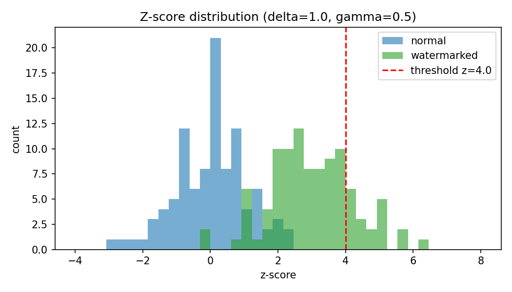
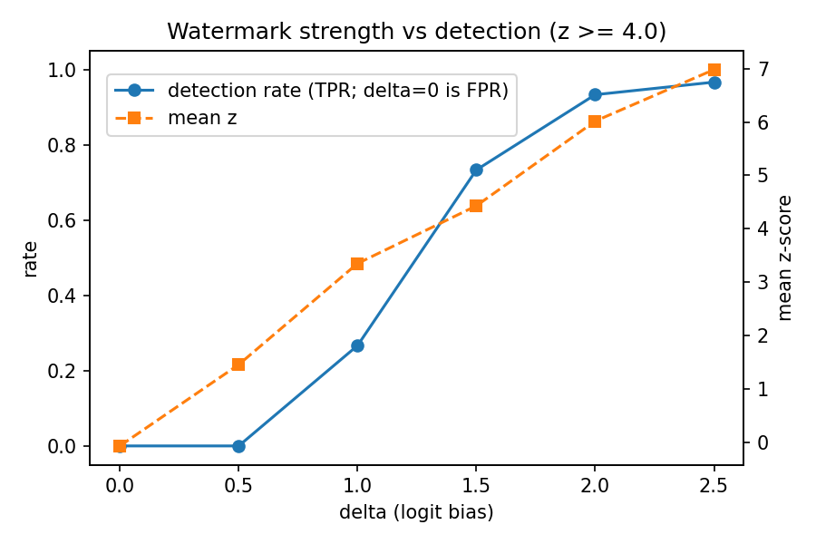
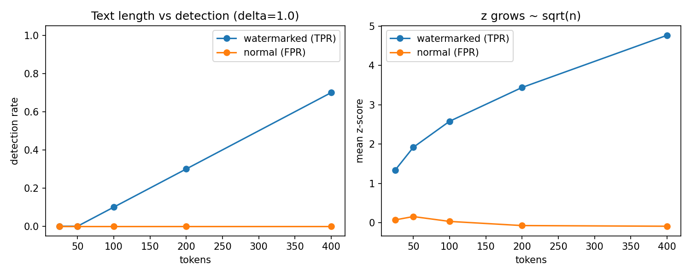
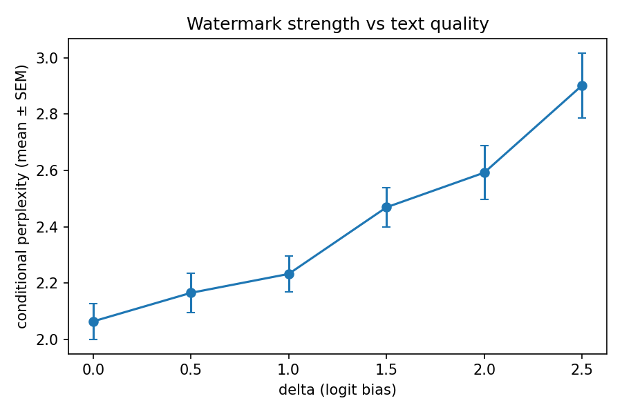

# How the V0 Watermark Works, and How We Got These Results

This document explains the method end to end. It starts with the idea, then covers the code path for generation and detection, the statistics, how the experiments were run, and why the numbers came out the way they did. Every number here comes from `experiments/*.csv` or from a run shown below.

---

## 1. The idea in one paragraph

An LLM writes text one token at a time. Before each token it produces a score, called a logit, for all 151,936 tokens in its vocabulary. We hide a signal in which tokens it picks. At every step we use a secret key to split the vocabulary into two halves: green and red. Green tokens get a small bonus δ added to their logits. The model still writes naturally, but it leans slightly toward green tokens. Normal text lands on green about 50% of the time by chance. Watermarked text lands on green noticeably more often. Anyone who has the key can rebuild the same green/red split for every token and count. Too many green tokens is statistical evidence of the watermark.

---

## 2. Generation: what happens at every token

```text
previous 4 tokens ─┐
                   ├─► SHA-256 ─► 64-bit seed ─► shuffle vocabulary ─► first 50% = GREEN
secret key ────────┘

model logits ─► +δ on GREEN ─► ÷ temperature ─► top-p filter ─► sample next token
```

### 2.1 Context → seed (`watermark.context_seed`)

```python
message = secret_key + "|" + "t1,t2,t3,t4"      # last CONTEXT_WIDTH = 4 token ids
seed    = first 8 bytes of SHA-256(message)       # integer in [0, 2^64)
```

- **SHA-256, not Python's `hash()`:** Python salts its hash per process, so the seed would change between runs. SHA-256 gives the same seed on any machine at any time. `tests/test_hashing.py` pins this.
- **Commas between ids:** they keep `[1, 23]` and `[12, 3]` from hashing to the same message.
- **Why the key matters:** without it, nobody can reproduce the seeds, so nobody can tell which tokens were green.

### 2.2 Seed → green list (`watermark.get_green_mask`)

The seed initialises NumPy's random generator. The generator makes a random permutation of all 151,936 token ids, and the first `int(151936 × 0.5) = 75,968` ids become green. The result is a boolean mask with one True/False per token. The same seed always gives the same mask, and a different context gives an unrelated mask. The test checks that two different contexts share about 50% of their green tokens, which is what independent random halves should do.

Because the context changes at every step, the green list changes at every step. No token is always favoured, so the watermark cannot be spotted by simple word counts.

### 2.3 Bias → sample (`watermark.apply_watermark`, `generate.sample_next_token`)

```python
logits = logits + green_mask * delta           # red tokens unchanged
logits = logits / temperature                  # T = 0.8
# top-p = 0.95: keep the smallest set of tokens covering 95% of probability
next_token = multinomial(softmax(logits))
```

This is the real trace from our smoke test (`generate.py --delta 2.0 --debug-steps 6`):

```text
[step 0] token='GPS'     seed=5664824690781434739  greens=75968 is_green=False logit 20.554 -> 20.554
[step 1] token=','       seed=94579070231215611    greens=75968 is_green=True  logit 20.995 -> 22.995
[step 2] token=' which'  seed=16654500719486710826 greens=75968 is_green=True  logit 20.495 -> 22.495
[step 3] token=' stands' seed=14372785894287709853 greens=75968 is_green=True  logit 22.200 -> 24.200
[step 4] token=' for'    seed=3088588792940557566  greens=75968 is_green=True  logit 27.237 -> 29.237
[step 5] token=' Global' seed=2422859459078427346  greens=75968 is_green=False logit 22.283 -> 22.283
```

The trace shows three things:

- Every step has a different seed.
- Exactly half the vocabulary is green.
- Only green tokens moved, by exactly +2.0.

Step 5 picked the red token " Global". After "GPS, which stands for", the model is so sure of " Global" that a +2 bonus on other tokens could not beat it. This is the main limit on watermark strength, covered in section 5.2.

### 2.4 The generation loop (`generate.generate_ids`)

We wrote our own loop instead of calling Hugging Face's `model.generate()`, so the logits are visible and editable at every step. Implementation details that matter:

- **KV cache:** after the prompt, each step feeds in only the one new token. The model reuses its cached attention state, so the cost of a step does not grow with the text.
- **Batching with left padding:** 10 prompts are generated at once. `attention_mask` and explicit `position_ids` make padding invisible to the model. Each row gets its own green mask from its own history.
- **No re-tokenisation:** token ids are appended directly, as the guide's Section 41 asks.
- **`torch.inference_mode()`:** no gradients are stored.
- **Seeded sampler:** normal and watermarked runs use the same sampler seed for the same prompt, so each pair differs only by the watermark.
- **Chat template:** prompts are wrapped in Qwen's chat format, so the Instruct model answers instead of continuing the prompt.

Normal generation uses the same loop with the watermark turned off, so the two conditions are directly comparable.

---

## 3. Detection: how we find the watermark (`detect.py`)

The detector needs only three things: the text, the secret key, and the tokenizer with its vocabulary size. It does not need the LLM itself.

```text
text ─► tokenize ─► for each position i ≥ 4:
                        seed_i = SHA-256(key | tokens[i-4..i-1])
                        green_i = green_mask(seed_i)[tokens[i]]
                   ─► G = number of green tokens, n = tokens scored
                   ─► z-score
```

- **Skipping the first 4 tokens:** during generation, the first few tokens were seeded partly by prompt tokens. The detector never sees the prompt, so it cannot score those positions.
- **Detecting from text, not stored ids:** the detector works like a real one would. It gets text only and re-tokenises it. Decoding and re-encoding gave back the exact generated ids in 98–99% of samples. The rest differ by a token or two, which barely affects the score.

### 3.1 The z-test

If the text is **not** watermarked, the writer knew nothing about the green lists. Each scored token is then green with probability γ = 0.5, independently:

$$G \sim \text{Binomial}(n,\gamma), \qquad z = \frac{G - n\gamma}{\sqrt{n\gamma(1-\gamma)}}$$

The z-score counts how many standard deviations the green count sits above chance. We flag the text when z ≥ 4. Under the null hypothesis, a false positive at that threshold has probability about 3 × 10⁻⁵.

Worked example from the smoke test (96 tokens scored):

| text | G / n | green ratio | z | verdict |
|---|---|---|---|---|
| watermarked (δ=2) | 75 / 96 | 0.781 | (75 − 48)/√24 = **5.51** | detected |
| normal | 57 / 96 | 0.594 | (57 − 48)/√24 = **1.84** | not detected |

The detector returns every intermediate value (n, G, ratio, expected ratio, z, p-value, verdict), not just True or False.

---

## 4. How the experiments were run (`evaluate.py`)

| Experiment | What varies | Samples | Fixed |
|---|---|---|---|
| `baseline` | normal vs watermarked | 20 prompts × 5 seeds × 2 = 200 | δ=1.0, γ=0.5 |
| `delta` | δ ∈ {0, 0.5, 1, 1.5, 2, 2.5} | 10 prompts × 3 seeds × 6 = 180 | γ=0.5 |
| `gamma` | γ ∈ {0.25, 0.5, 0.75} | 10 × 3 × (3 watermarked + 1 normal) | δ=1.0 |
| `length` | scored length 25→400 tokens | 10 × 3 × 2, 400 tokens each | δ=1.0, γ=0.5 |

These stayed the same in every experiment: model `Qwen2.5-0.5B-Instruct` (fp32, CPU), T = 0.8, top-p = 0.95, context width 4, max 200 new tokens (400 for the length sweep), and threshold z ≥ 4. Only the variable under test changed, as the guide's Section 51 asks.

Each generated sample went through the same four steps:

1. Generate the text.
2. Compute its **perplexity**: how surprised the unwatermarked model is by the generated tokens, given the prompt. Lower means more natural to the model.
3. Compute its **3-gram repetition rate**, a cheap check for degenerate, looping text.
4. Decode, re-tokenise and **detect**.

- **Measuring rates:** the **detection rate (TPR)** is the share of watermarked samples with z ≥ 4. The **false-positive rate (FPR)** is the same share among normal samples.
- **Length sweep:** EOS was blocked so every sample reached 400 tokens. We then scored the first 25, 50, 100, 200 and 400 tokens of the same samples. Every length therefore compares the same texts.

Every sample is one row in `experiments/<name>_results.csv`, alongside the metadata files that record the setup.

---

## 5. Results and why they look this way

### 5.1 The null model holds: normal text scores z ≈ 0



On 100 normal samples, the mean z was 0.03 with standard deviation 1.04, and the highest was 2.29. A standard normal distribution N(0, 1) predicts almost exactly this. So the assumption that normal text is green half the time is correct for this tokenizer and hashing scheme. Across all normal samples in every experiment, **none reached z ≥ 4**. This rules out Failure Mode 2 in the guide ("normal text has high z-scores").

At δ = 1.0 the watermarked distribution clearly moves right (mean z = 3.01), but much of it still sits below 4. That is why the baseline detected only 19%.

### 5.2 Why the green ratio stays far below 100%

The ratio is capped by two things.

**First, the bias is small compared with the model's confidence.** Temperature divides the logits after the bias, so the effective bonus is δ/T. In the best case, where every token is equally likely, the chance of drawing green is

$$P(\text{green}) = \frac{\gamma e^{\delta/T}}{\gamma e^{\delta/T} + (1-\gamma)}$$

For δ = 1, T = 0.8, γ = 0.5 that is e^1.25 / (e^1.25 + 1) ≈ **0.78**.

**Second, many steps have low entropy.** When the model is nearly certain ("stands for → Global"), it picks the same token whatever its colour. Those steps are green only 50% of the time.

Mixing high-entropy and low-entropy steps gives the observed **0.62** at δ = 1. This is also the reason behind the V1 idea of an entropy-adaptive δ.

### 5.3 Why detection grows with δ and with length

For a green ratio p over n scored tokens:

$$z = \frac{(p-\gamma)\sqrt{n}}{\sqrt{\gamma(1-\gamma)}} = 2(p-0.5)\sqrt{n} \quad (\gamma = 0.5)$$

So z grows with **how strongly** we bias (p) and with **how much text** we have (√n). The measured data follows this closely:

| δ | measured p | n | predicted z = 2(p−0.5)√n | measured mean z |
|---|---|---|---|---|
| 1.0 | 0.622 | 189 | 3.36 | 3.35 |
| 2.0 | 0.722 | 183 | 6.00 | 6.02 |

The same formula tells us how much text δ = 1 needs. Reaching z = 4 takes n ≈ (4 / 0.244)² ≈ **270 tokens** on average. Our outputs had about 185–190 scored tokens, so most fell short. That is the 19–27% detection rate. The length sweep confirms it: at 400 tokens, detection rose to 70%.




| length (tokens) | 25 | 50 | 100 | 200 | 400 |
|---|---|---|---|---|---|
| watermarked mean z | 1.34 | 1.92 | 2.58 | 3.44 | 4.76 |
| detection rate | 0.00 | 0.00 | 0.10 | 0.30 | 0.70 |
| normal detection rate (FPR) | 0 | 0 | 0 | 0 | 0 |

Each doubling of length multiplies z by about 1.4 ≈ √2, as the formula predicts.

### 5.4 The quality cost



Perplexity rose steadily with δ: 2.06 for normal text, then 2.17, 2.23, 2.47, 2.59 and 2.90 as δ went from 0.5 to 2.5. The bias pushes the model toward tokens it rated slightly lower, so the reference model finds the text a little more surprising.

- **Why the values are so low:** the model is scoring its own low-temperature output, so perplexity around 2 is expected.
- **What matters:** the relative increase between conditions, not the absolute value.
- **Repetition:** the 3-gram repetition rate did not increase.
- **Manual reading:** δ = 2.5 text is still fluent. For example, "The Attention mechanism is a key component in transformers, a type of sequence-to-sequence model used in NLP…"

This is the core trade-off:

| δ | detection @ ~185 tokens | perplexity increase |
|---|---|---|
| 1.0 | 27% | +8% |
| 1.5 | 73% | +20% |
| 2.0 | 93% | +26% |
| 2.5 | 97% | +41% |

δ ≈ 2.0 is a reasonable working point for outputs of about 200 tokens. Beyond it, extra detection costs a lot more quality.

### 5.5 Green fraction

| γ | 0.25 | 0.50 | 0.75 |
|---|---|---|---|
| green ratio (expected γ) | 0.352 (0.25) | 0.622 (0.50) | 0.812 (0.75) |
| mean z | 3.25 | 3.35 | 1.97 |

- **Normal text:** its green ratio matched γ in every case (0.251, 0.497, 0.738), so the detector is calibrated for any γ.
- **γ = 0.75 is weaker:** most tokens are already green, so a +δ bonus on green has little left to change. The shift above the baseline is small compared with the noise.
- **γ = 0.25 vs 0.5:** these gave almost the same z. There is no reason to move off 0.5 in V0.

---

## 6. How we know the implementation is correct

1. **Unit tests (25 passing):**
   - The hash is deterministic, and its value is pinned.
   - Different contexts or keys give different seeds.
   - Green lists have the exact size, are unique and are deterministic.
   - The bias touches only green tokens and never modifies its input in place.
   - The z formula is correct, and random tokens give z ~ N(0, 1).
   - A wrong key detects nothing.
2. **End-to-end test:** the real generation loop runs on a tiny random model with δ = 8, and the detector rebuilds the lists from the output ids. More than 90% of tokens come out green, so the generator and detector agree exactly. Without this, all z-scores near 0 would suggest Failure Mode 1 (a mismatch between the two).
3. **Debug trace:** section 2.3 shows the bias applied only to green tokens at the logit level.
4. **Statistics:** normal text follows N(0, 1), and watermarked z matches the formula 2(p − 0.5)√n. Both are internal consistency checks that a buggy implementation would be unlikely to pass.

---

## 7. What these results do and don't show

**They show** that the watermark is **statistically detectable under the tested conditions**. That covers this model, T = 0.8, top-p = 0.95, unmodified text, and outputs of 25–400 tokens. They also show a clear, measurable detection/quality trade-off.

**They don't show:**

- **An exact false-positive rate.** "0%" comes from only 30–100 control samples, so it really means below about 1–3%. A final threshold needs hundreds or thousands of controls and a ROC curve.
- **Robustness.** Paraphrasing, editing, or PDF/OCR conversion (V2) were not tested. Changing even a few tokens changes the context hash for the next 4 positions.
- **Security.** The watermark could be removed or spoofed by someone who studies enough outputs. That is out of scope for V0.
- **Behaviour on other models.** Only Qwen2.5-0.5B was tested. Larger models have lower-entropy outputs, which weakens the watermark at the same δ.

---

## 8. Reproduce

```bash
cd llm-watermark
python -m pytest -q tests
python evaluate.py baseline --num-prompts 20 --seeds 5
python evaluate.py delta  --num-prompts 10 --seeds 3
python evaluate.py gamma  --num-prompts 10 --seeds 3
python evaluate.py length --num-prompts 10 --seeds 3
```

The full run took about 1.9 h on 8 CPU cores at about 22 tokens/s. The metadata for each run (model revision, library versions, all parameters, key redacted) is in `experiments/*_metadata.json`.
