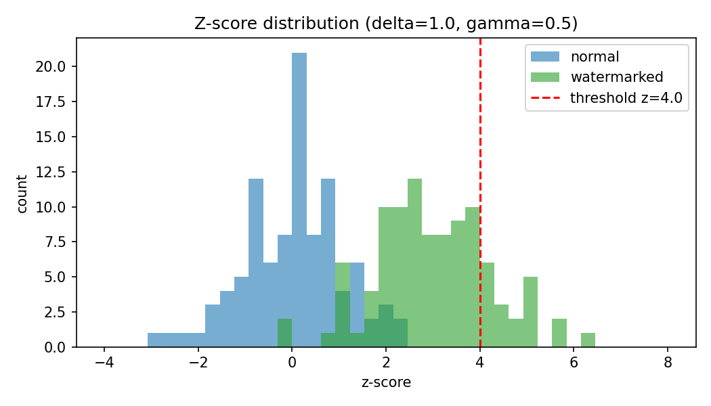
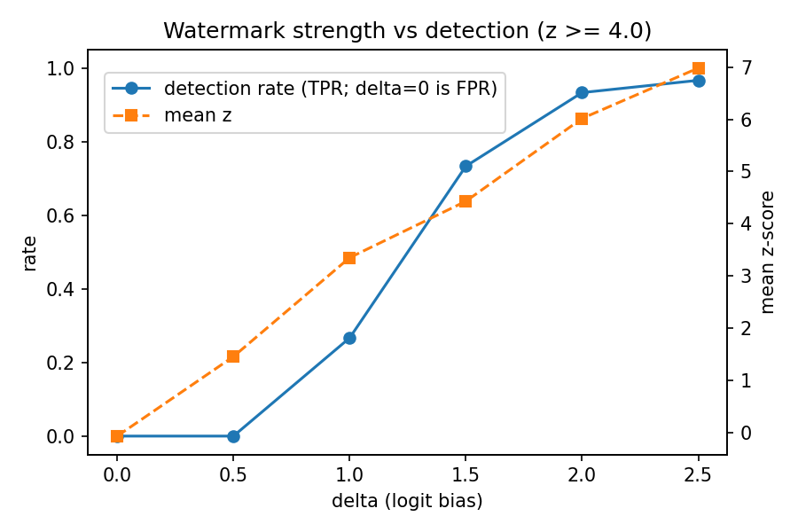

# Context-Dependent Statistical Watermarking for LLM-Generated Text (V0)

This project builds a watermark for text written by a large language model (LLM), implemented from scratch. It then measures how well the watermark can be detected and what it costs in text quality.

The watermark is added while the model generates text. No training or fine-tuning is needed. Anyone who holds the secret key can later check a piece of text and get a statistical score saying whether it was watermarked.

This is stage **V0** of a larger study. V0 asks whether we can create and detect the watermark at all, and what the detection vs quality trade-off looks like. Robustness to paraphrasing, PDF conversion and similar changes is left for later stages.

For a step-by-step explanation of the method and the results, see [HOW_IT_WORKS.md](HOW_IT_WORKS.md).

---

## How it works (short version)

At every generated token:

1. The previous 4 tokens and a secret key are hashed with SHA-256 into a seed.
2. The seed randomly splits the vocabulary into a **green** half and a **red** half.
3. Green tokens get a small bonus **δ** added to their logits, then the next token is sampled as usual (temperature + top-p).

Normal text lands on green tokens about 50% of the time by chance. Watermarked text lands on green more often.

The detector re-tokenises the text and rebuilds the same green lists using the key. It then counts green tokens and runs a z-test:

$$z = \frac{G - n\gamma}{\sqrt{n\gamma(1-\gamma)}}$$

Here G is the number of green tokens, n is the number of tokens scored, and γ is the green fraction. Text is flagged as watermarked when z ≥ 4.

---

## Results

Model: Qwen2.5-0.5B-Instruct on CPU, temperature 0.8, top-p 0.95, γ = 0.5, context width 4, outputs of about 190 tokens. Perplexity is a quality proxy: lower means the text looks more natural to the model.

| δ | normal mean z | watermarked mean z | detection rate | false-positive rate | perplexity (normal 2.06) |
|---|---|---|---|---|---|
| 0.5 | -0.07 | 1.45 | 0% | 0% | 2.17 |
| 1.0 | -0.07 | 3.35 | 27% | 0% | 2.23 |
| 1.5 | -0.07 | 4.43 | 73% | 0% | 2.47 |
| 2.0 | -0.07 | 6.02 | 93% | 0% | 2.59 |
| 2.5 | -0.07 | 6.98 | 97% | 0% | 2.90 |

- **Normal text behaves as expected.** Across 100 normal samples, z had mean 0.03 and standard deviation 1.04, which matches the random baseline the test assumes. No normal sample in any experiment reached z ≥ 4.
- **Longer text is easier to detect.** At δ = 1.0, mean z grew from 1.34 at 25 tokens to 4.76 at 400 tokens, roughly in proportion to √n. Detection rose from 0% to 70%.
- **Green fraction:** γ = 0.25 and 0.5 gave similar z scores (3.25 and 3.35). γ = 0.75 was weaker (1.97).
- **Recommended setting:** for outputs of about 200 tokens, δ ≈ 2.0 gives 93% detection for a modest perplexity increase.




**Limits:**

- The 0% false-positive rate comes from 30–100 control samples, so it only shows the true rate is below about 1–3%.
- Robustness to editing, paraphrasing or document conversion has not been tested.
- The watermark is **statistically detectable under the tested conditions**. That is not a claim that it cannot be removed.

---

## Project layout

```text
llm-watermark/
├── config.py          # all parameters: model, key, γ, δ, context width, sampling, threshold
├── watermark.py       # context_seed, get_green_list, get_green_mask, apply_watermark
├── generate.py        # custom batched KV-cache generation loop + CLI
├── detect.py          # z-score detector + CLI
├── quality.py         # conditional perplexity, 3-gram repetition rate
├── evaluate.py        # experiments: baseline, delta, gamma, length, all
├── prompts/prompts.txt
├── tests/             # hashing, partition, detector, generator↔detector tests
├── experiments/       # CSV results, summaries, metadata, logs, plots/
├── README.md
└── HOW_IT_WORKS.md
```

---

## How to reproduce

### 1. Requirements

- Python 3.10 or newer
- About 3 GB of free RAM. The model is about 1 GB on disk and is downloaded automatically from Hugging Face on first run.
- A GPU is optional. The results above were produced on an 8-core CPU.

### 2. Set up the environment

```bash
git clone https://github.com/anishtoppo55/Minor_Project.git
cd Minor_Project/llm-watermark

python3 -m venv .venv
source .venv/bin/activate          # Windows: .venv\Scripts\activate
pip install -r requirements.txt
```

`requirements.txt` pins the exact versions used (torch 2.10.0, transformers 5.5.4). The default `torch` wheel may be CUDA or CPU depending on your platform. For a CPU-only install, see https://pytorch.org/get-started/locally/.

### 3. Set the secret key

The generator and detector must use the same key. Put it in a `.env` file, which is git-ignored:

```bash
echo 'WATERMARK_SECRET_KEY=your-private-key' > .env
```

If no key is set, the code uses the placeholder `CHANGE_THIS_KEY`. The results above were produced with the placeholder. Because the experiments only compare normal text against watermarked text under the same key, a different key gives statistically equivalent results, but not identical numbers.

### 4. Run the tests

```bash
python -m pytest -q tests
```

All 25 tests should pass. They run in a few seconds and do not download the model.

### 5. Try it on one prompt

```bash
# watermarked, printing the per-step seed / green flag / logit change for 5 steps
python generate.py --prompt "Explain how GPS works." --delta 2.0 --debug-steps 5 --output wm.json

# normal (no watermark)
python generate.py --prompt "Explain how GPS works." --no-watermark --output normal.json

# detect: extract the generated text from the JSON, then score it
python -c "import json; open('wm.txt','w').write(json.load(open('wm.json'))['text'])"
python detect.py --file wm.txt
```

`detect.py` prints JSON with the tokens evaluated, green count, green ratio, z-score, p-value and the final verdict. Use the same `--gamma` and `--context-width` that were used for generation.

### 6. Reproduce all experiments

```bash
python evaluate.py baseline --num-prompts 20 --seeds 5    # ~35 min on CPU
python evaluate.py delta    --num-prompts 10 --seeds 3    # ~31 min
python evaluate.py gamma    --num-prompts 10 --seeds 3    # ~22 min
python evaluate.py length   --num-prompts 10 --seeds 3    # ~22 min
```

Each command writes the following to `experiments/`:

- `<name>_results.csv`: one row per sample, with the generated text, z-score, green ratio, perplexity and so on.
- `<name>_summary.csv`: mean, std and median z, detection rate and mean perplexity per condition.
- `<name>_metadata.json`: model revision, library versions, hardware and all parameters, with the key redacted.
- `plots/*.png`: the graphs.

The delta sweep also writes `baseline_table.csv`, which is the table above. Generated texts for the baseline are written to `outputs/` as JSONL.

Useful options (`python evaluate.py --help`):

| option | default | meaning |
|---|---|---|
| `--delta`, `--gamma`, `--context-width` | 1.0, 0.5, 4 | watermark parameters |
| `--deltas`, `--gammas`, `--lengths` | 0.5…2.5, 0.25 0.5 0.75, 25…400 | sweep values |
| `--max-new-tokens`, `--temperature`, `--top-p` | 200, 0.8, 0.95 | generation |
| `--threshold` | 4.0 | detection threshold (z) |
| `--batch-size` | 10 | prompts generated in parallel |
| `--no-ppl` | off | skip perplexity to save time |

For a quick check that the whole pipeline works (under a minute):

```bash
python evaluate.py baseline --num-prompts 4 --seeds 1 --max-new-tokens 60 --delta 2
```

### Reproducibility notes

- The experiment seed (42) and the sampler seeds are fixed. Normal and watermarked runs share sampler seeds, so each pair is directly comparable.
- Exact token-for-token output can still differ across hardware, PyTorch versions and CPU vs GPU, because of floating-point differences. The statistics (mean z, detection rates) should match closely.
- To use a different model, set `WATERMARK_MODEL=<huggingface-model-id>`. Any causal LM with accessible logits should work.

---

## Roadmap

- **V1:** adaptive watermark strength, using a larger δ when the model is uncertain (high entropy).
- **V2:** robustness to TXT/DOCX/PDF conversion, OCR, Unicode/whitespace normalisation, paraphrasing and reordering.
- **V3:** a watermark designed specifically to survive those transformations.
